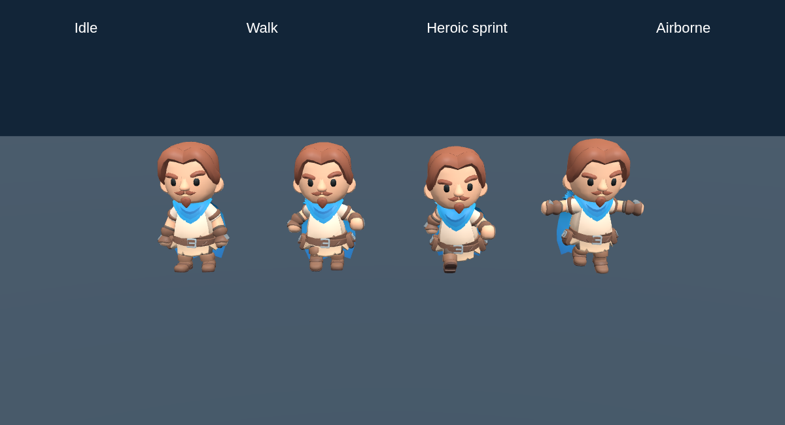
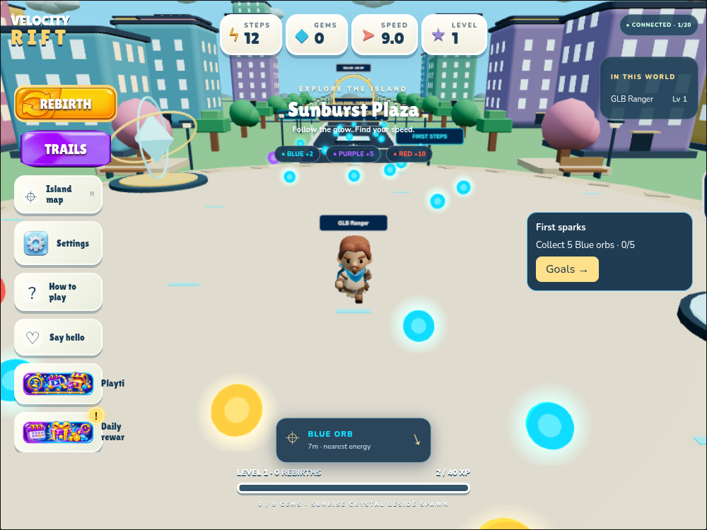

# KayKit Ranger integration

Based on `feature/v5-progression-rewards` (`2420b36`); selected assets copied from `3d-glb-assets` (`2ff1fa3`). The asset branch remains the complete model archive. This change imports only Ranger, MovementBasic and General, totalling 2,002,576 bytes. No world assets, gameplay balance, physics, server protocol, progression or pet models changed.

## Character and ownership

Ranger and Rogue have matching named bones and rest transforms with Rig Medium. Ranger was selected for its readable face, scarf and forward-running silhouette. The inspected Advanced bundle adds weapon/strafe/crouch actions that are unnecessary here; it is neither imported nor requested.

`src/assets/hero.ts` lazily loads GLBs with GLTFLoader, validates animation bindings, retains embedded texture/color-space/material configuration, and uses SkeletonUtils for independent skeletons. Mesh geometry, materials and textures are shared. Each avatar owns its mixer and bone textures. Meshes with the same skin share one bone palette inside that avatar; separate avatars never share bones. Failed loads remain failed for the page session to avoid retry storms; a reload retries. Network requests time out after 15 seconds. The procedural avatar remains visible until all required assets are ready, including on failures.

The source bounding box is normalized to the existing 3.55-unit visual height and placed with its lowest point at the existing player root. Ranger already faces +Z, matching game movement. Animation root X/Z translation is stripped; all translation/facing remains controlled by existing prediction/interpolation. Names, shadow, Trail and pets keep their original attachment roots and collision geometry is unchanged.

Disconnect disposes each clone's skeleton resources, stops/uncaches its mixer and removes its group. Shared resources are retained for reconnect/reuse and released on page exit (except bfcache suspension). Animation preview geometry is disposed after clips are extracted. Hidden procedural bone animation is skipped after GLB activation.

## Animation mapping

| State | Clip |
| --- | --- |
| Idle | `Idle_A` |
| Walk | `Walking_A` |
| Jog, braking | `Running_A` |
| Sprint, high speed, acceleration, turning | `Running_B` |
| Takeoff | `Jump_Start` |
| Airborne | `Jump_Idle` |
| Landing | `Jump_Land` |

Crossfades last 160 ms; locomotion transitions preserve cycle phase. Takeoff/landing play once. Cadence uses actual rendered horizontal displacement capped by actual movement velocity, including remote interpolation and collision stops. Measured planted-toe speeds at this scale are 1.14, 5.07 and 7.49 units/second for walk, run A and run B; playback rate scales against these values. Turning uses existing interpolated facing. The existing greeting uses a temporary blended arm overlay. No animation data is transmitted.

Nearby avatars update every frame. Beyond 60 units, mixers update at 12 Hz on low quality or 20 Hz otherwise. Rendering keeps skinned meshes visible independently of static bind-pose bounds.

## Validation

Baseline and integration: `npm test` — 53 passed. `npm run build` — passed; Vite retains its existing large-main-chunk advisory. Hero asset/gameplay/fallback, two-client multiplayer, production desktop/mobile, and V5 reward/saving/reconnect browser checks all passed. The V5 check initially timed out while local services were unavailable and passed after restarting them.

Run the backend (`npm run server`) and Vite (`npm run dev -- --port 5173`), then:

- `node tests/hero-assets-browser.mjs`: three requests across multiple concurrent clones, independent skeletons/shared mesh resources, embedded texture, all state bindings, mixer cleanup without corrupting peers, reduced update cadence. Produces close-up pose and greeting screenshots.
- `node tests/hero-browser.mjs`: actual game idle/run/jump screenshots, no missing texture/bone errors, exactly three GLB requests, mobile viewport with blocked GLBs retains procedural fallback.
- `node tests/multiplayer-browser.mjs`: two real Colyseus clients; both Heroes load, remote run/jump clips change, earned/equipped Trail replicates, disconnect removes avatar. Simulated latency reached 288 ms RTT; maximum prediction error 0.388 units, zero hard corrections.
- `node tests/hero-performance-browser.mjs`: sequential procedural/GLB rendering comparison in the same scene.
- `node tests/production.mjs`: requires `npx vite preview --port 4173`; desktop/mobile production smoke.
- `npx tsx tests/v5-browser.mjs`: existing local reward/quest/saving regression; uses local test profiles, not real ads.

Visual review covers face direction, texture, ground contact, run/jump silhouettes, greeting and Trail placement. Screenshots are generated under `artifacts/hero/`; selected review images are included below.

## Performance and limits

At 640×480, low quality, SwiftShader, 60-frame sequential samples: procedural median 116.3 ms / p95 172.9 ms; Ranger median 124.3 ms / p95 163.6 ms. Draw calls decreased from 297 to 277; triangles increased from 134,790 to 135,290. This is a software-rendering comparison, not a physical mobile/desktop frame-rate certification. Absolute frame rates in this cloud environment are poor for both versions. Hardware and a full 20-player performance pass remain unverified.

Only three GLBs (2.00 MB) load; the loader is a separate lazy chunk. There is no per-frame skeleton network traffic. Ground-contact cadence is calibrated to the supplied clips, but this is not a terrain foot-IK system: exact foot locking on slopes or at extreme boosted speed is not guaranteed. At extreme speeds the cadence is intentionally stylized and follows real travel.

Original KayKit CC0 license notices are in `public/licenses/KayKit-Adventurers.txt` and `public/licenses/KayKit-Animations.txt`.

## Review delivery

Working branch: `feature/glb-hero-integration`. Target base: `feature/v5-progression-rewards`. GitHub API requests are denied (`Forbidden`) by this environment, so automatic pull-request creation is unavailable. Review/create link: https://github.com/MakingWavesW/VELOCITY-RIFT-SPEEDBOUND/compare/feature/v5-progression-rewards...feature/glb-hero-integration?expand=1
