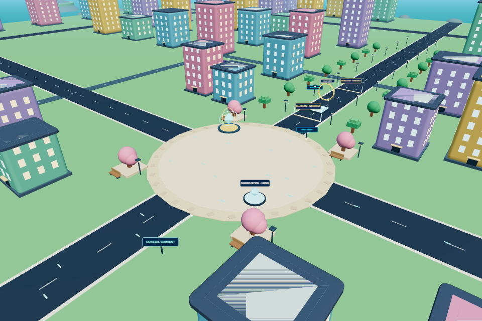
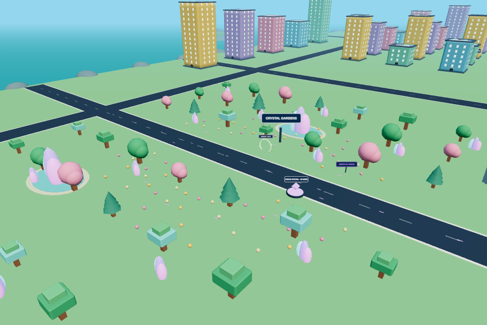
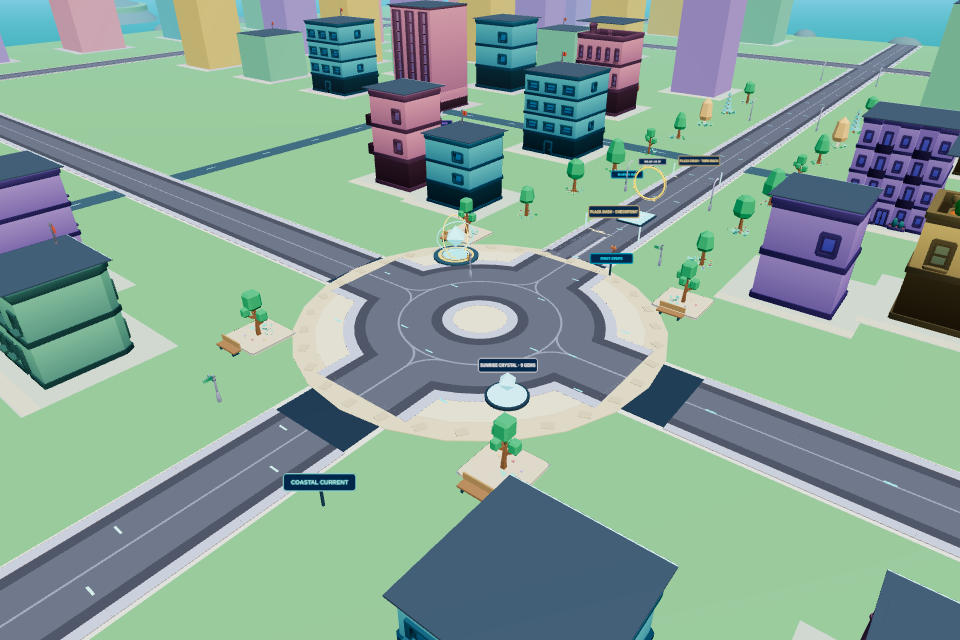
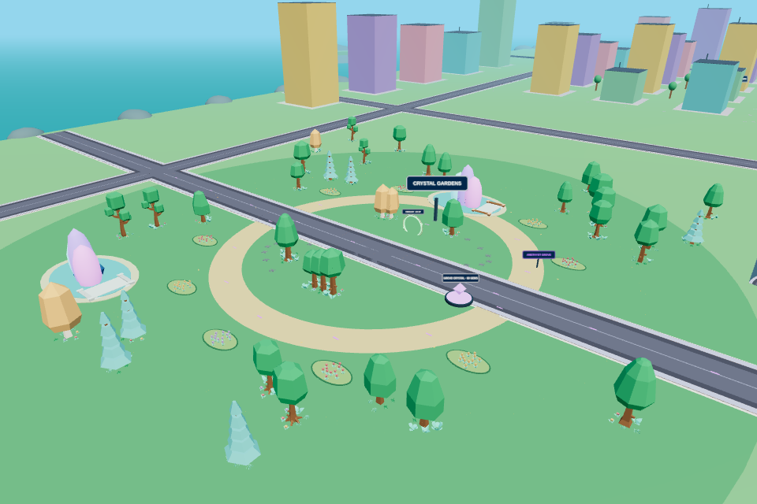

# Main City GLB environment — Stage 2

Working branch: `feature/glb-main-city-stage2`. Based on completed Hero integration `edea063`, which includes V5 progression `2420b36`. The source model archive comes from `3d-glb-assets` at `2ff1fa3`. Main was not modified.

## Environment

| District | Changes |
| --- | --- |
| Sunburst Plaza | Pastel commercial facades, tiled roundabout, paved planters, GLB trees and flowers, fountain spray at the existing Rift landmark, street furniture and directional signs. Spawn and pickup loops remain open. |
| Rainbow Downtown | Nineteen commercial/skyscraper variants across the existing building footprints, colored facades, sidewalks, crossroads, roof trim, flags and window emission at night. |
| Speedway Boulevard | Correctly oriented Kenney road tiles, shoulder lights, signage and shader-animated cyan energy strips. Existing launch pads and hoops remain in place. |
| Crystal Gardens | Mixed groves, planted flower beds, a continuous garden path, pond bridges, decorative jewels, GPU particles and occasional butterflies. Actual Crystal stations remain distinct and reachable. |
| Skyline Challenge | Imported platform cladding, roof markers and glowing ledges. Flat roof decks preserve the existing collision and landing heights. |
| Coastal Adventure | Paved boardwalk shoulders, coastal cabins, two palm varieties, rocks, GLB bridge sections and pier rails. Water shimmer and synchronized sunset/night colors preserve the current coastline. |

The world remains 880 units across. Existing building/platform records, movement rules, Hero animation, Pet models, Trails, orbs, currencies, quests, rewards, save format, advertisements and Colyseus messages are preserved. Explicit `scenery` volumes cover trunks, lamps, signs, benches, cabins and bridge edges; soft vegetation and decorative markers are intentionally nonblocking. The original rooftop route remains traversable. Road checks compare against original solids, preserving existing blocks instead of silently moving buildings.

## Assets and build

- Full collection: **656 GLBs**, archived under `assets/library/models/` with original directory names and texture dependencies.
- Runtime: **66 GLBs** — 19 commercial buildings, 12 road/street models, 26 nature models, 6 platform/decorative models, and the existing 3 Hero/animation files.
- Raw runtime GLBs: **6,058,548 bytes**. Staged GLBs plus referenced textures: **6,092,118 bytes**.
- `assets/runtime-models.json` is the allowlist. `scripts/stage-assets.mjs` stages it before both dev and build, automatically including external image/buffer references. Generated city/nature/platform files are ignored by Git; source assets remain tracked outside `public/`.
- `scripts/verify-build.mjs` runs after every production build and rejects missing, modified or extra GLBs. Hero URLs are unchanged.
- Original Kenney and KayKit CC0 license notices ship in `public/licenses/`.

`src/assets/gltf.ts` is extracted from the Stage 1 loader, shared by Hero and scenery. It caches promises and textures, limits failed assets to one attempt per page session, times requests out, and retains page-lifetime source resources. Scenery streams with three concurrent loads, prioritizes nearer models, keeps procedural fallbacks on failure and shares cached geometry/material resources. Instance matrices are rebuilt only after movement, quality changes or completed loads. Foliage and energy motion update GPU uniforms rather than hundreds of object transforms.

`src/world/cityLayout.ts` defines reusable visual placement, while `shared/cityDecor.ts` provides stable prop positions and collision footprints. World GLBs are normalized to measured bounds; building facades fit authoritative boxes and imported horizontal root offsets are retained for poles/trunks. The straight-road and bridge assets use different native axes, verified with top-down renders.

High/Medium/Low are available in the existing graphics menu and persist across visits. They adjust scenery range/density, particle budgets, pixel ratio and shadow resolution. Distant buildings retain simple proxies. Reduced motion freezes foliage, butterflies, particles, clouds, crystals, fountain spray and energy motion. The existing 12-minute server-clock day/night cycle remains unchanged; windows and lamps use emission rather than additional dynamic lights.

## Validation

- Baseline: **53/53** tests passed.
- Stage 2 automated suite: **56/56** passed, including exact manifest/dependency checks, matching building footprints, protected pickup routes, ramp approaches, Crystal access and the existing rooftop loop.
- Production build and postbuild asset verification passed. Vite retains its large-main-chunk advisory.
- Two real Colyseus clients passed animated Hero running/jumping, earned/equipped Trail replication, simulated latency and disconnect cleanup. Maximum measured RTT: 283.8 ms; prediction error: 0.388 units; zero hard corrections.
- Hero asset regression passed: cached loads, independent skeletons, shared meshes/materials, one palette per avatar, animation binding and cleanup.

- Real gameplay browser pass: movement, Crystal purchase, Pet equipment, night controls, touch joystick and mobile layout. V5 regression passed rewards, calendar, badges, unavailable real-ad offers, keyboard focus and saved-session reconnect.
- Stage 2 browser pass: desktop, Medium switching, mobile Low and deliberately failed environment requests. Hero assets still loaded and movement remained usable with procedural scenery fallbacks; no shader or JavaScript errors.
- Production desktop/mobile browser pass, palette preservation/cache tests and six-district/day-night visual pass completed successfully. All 63 environment assets loaded during the district tour without missing models.

## Measured performance

The paired scene benchmark uses Chromium SwiftShader, a fixed plaza camera, pixel ratio 1, 60 sampled animation frames and sequential contexts. It excludes UI, Hero and multiplayer so the comparison isolates the environment. Desktop is 960×640/High and mobile is a 390×844/Low viewport; this is **not physical mobile hardware**. Frame times include GPU/software-rendering completion, unlike the separate visual fixture's CPU submission measurements.

| Metric | Stage 1 desktop | Stage 2 desktop | Stage 1 mobile viewport | Stage 2 mobile viewport |
| --- | ---: | ---: | ---: | ---: |
| Median frame | 157.6 ms | 206.9 ms | 102.0 ms | 115.4 ms |
| p95 frame | 305.2 ms | 378.1 ms | 129.2 ms | 297.4 ms |
| Draw calls | 324 | 237 | 194 | 158 |
| Triangles | 80,960 | 110,405 | 50,282 | 41,158 |
| GPU texture objects | 9 | 12 | 6 | 8 |
| JS heap | 34.6 MB | 52.4 MB | 31.7 MB | 46.1 MB |
| Environment model/dependency bytes | 0 | 3,107,218 | 0 | 2,023,682 |
| Environment GLB requests | 0 | 51 | 0 | 35 |
| Scene ready | 763 ms | 2,523 ms | 642 ms | 1,257 ms |

Stage 2 reduces draw calls by 27% on High and 19% on Low, but the final run still measured **31% higher median frame time on High and 13% higher on Low**, with worse p95. Earlier paired runs varied (High +21%, Low approximately unchanged); the final values above are reported without selecting the fastest run. Additional geometry, materials and streaming increase memory and startup cost. Hardware performance acceptance remains outstanding.

Optimization includes instanced proxies, reduced detail ranges, Lambert lighting on High/Medium and inexpensive directional shading on Low, equivalent palette texture reuse, and one-sample window emission. Flat palette regions are baked only after validating every covered texel; detailed textures remain intact. These changes reduced High plaza triangles from the first implementation's 190,070 to 110,405 and GPU textures from 35 to 12.

The real-game browser run separately includes the cinematic intro and Hero. Its recorded startup time is not comparable to the isolated scene-ready measurement. Raw metrics are retained in `docs/metrics/city2/`; timings are observations, not FPS guarantees.

Useful commands (backend on 2567, dev preview on 5173, production preview on 4173):

```sh
npm test
npm run build
node tests/hero-assets-browser.mjs
node tests/multiplayer-browser.mjs
npx tsx tests/city-browser.mjs
npx tsx tests/v5-browser.mjs
node tests/city2-browser.mjs
node tests/production.mjs
node tests/city2-visual-browser.mjs
node tests/city2-performance-browser.mjs
node tests/palette-browser.mjs
```

The performance script additionally expects a separate Stage 1 checkout (`edea063`) served on localhost:5180. It measures the same camera, viewport, quality and renderer settings sequentially. The visual fixture visits all six districts without changing server gameplay; actual multiplayer/gameplay tests use real inputs and sessions. Existing Windows startup scripts remain unchanged; their `npm run dev` invocation automatically stages the selected models.

## Packaging

| Build | Runtime GLBs | Expanded client | ZIP |
| --- | ---: | ---: | ---: |
| Stage 1 | 3 | 18,669,252 bytes | 15,361,501 bytes |
| Stage 2 | 66 | 22,782,334 bytes | 16,009,266 bytes |

The ZIP contains the contents of `dist/` at its root and was read back and CRC-checked. It includes no source model archive. Artifacts are generated under `artifacts/city2/`; the client still requires the existing multiplayer backend.

## Limits

Performance here is measured with Chromium/SwiftShader, not a physical desktop/mobile GPU. No 30/60 FPS claim is made. A 20-player physical-device stress pass remains outstanding. Facades use conservative box collisions and existing flat roof decks rather than arbitrary mesh-triangle physics. Distant models simplify to proxies, and camera changes can reveal a detail transition. Lighting uses efficient direct/ambient/emissive materials, not real-time global illumination or mirror reflections.

## Visual review

Before plaza:



Before gardens:



After plaza:



After gardens:



Remaining district views: [Downtown](images/city2/after-downtown.png), [Speedway](images/city2/after-speedway.png), [Skyline](images/city2/after-skyline.png), [Coast](images/city2/after-coast.png), [Night](images/city2/after-night.png).
